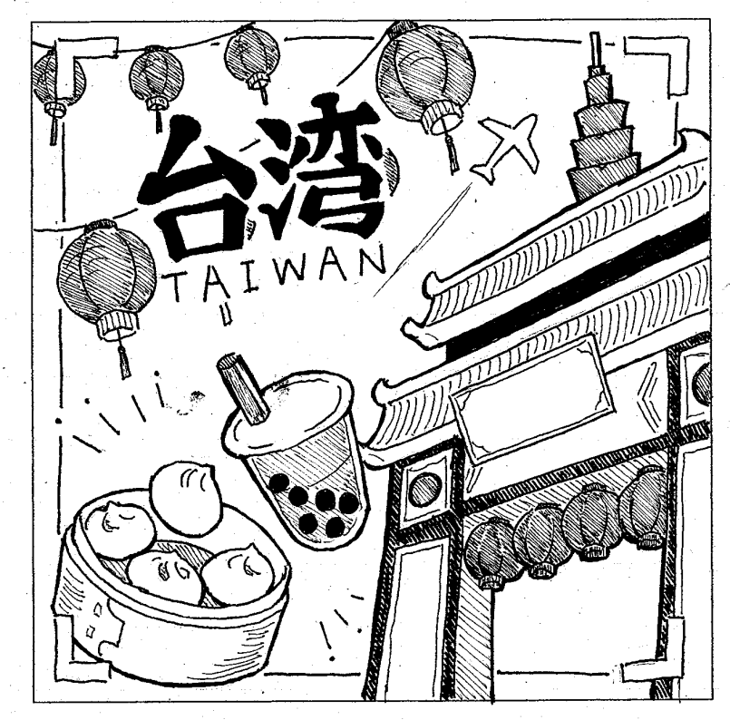
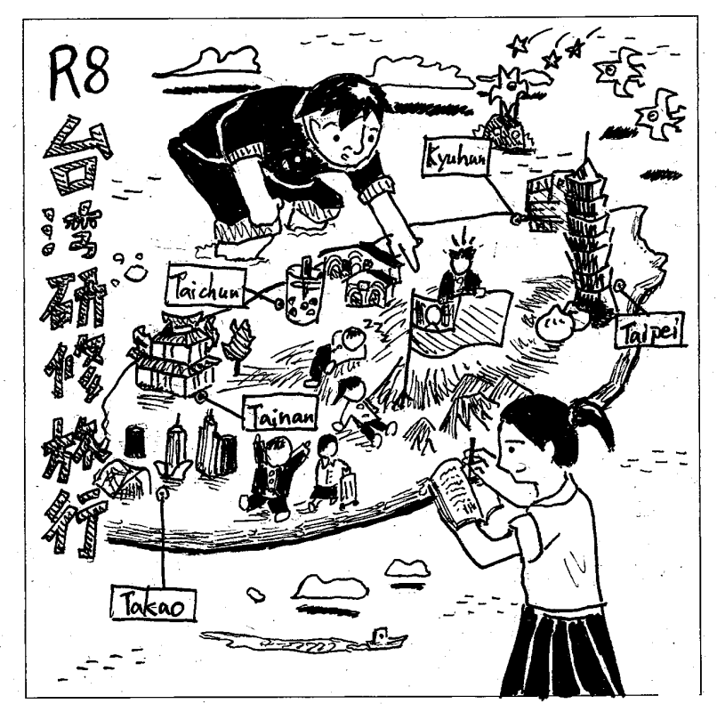
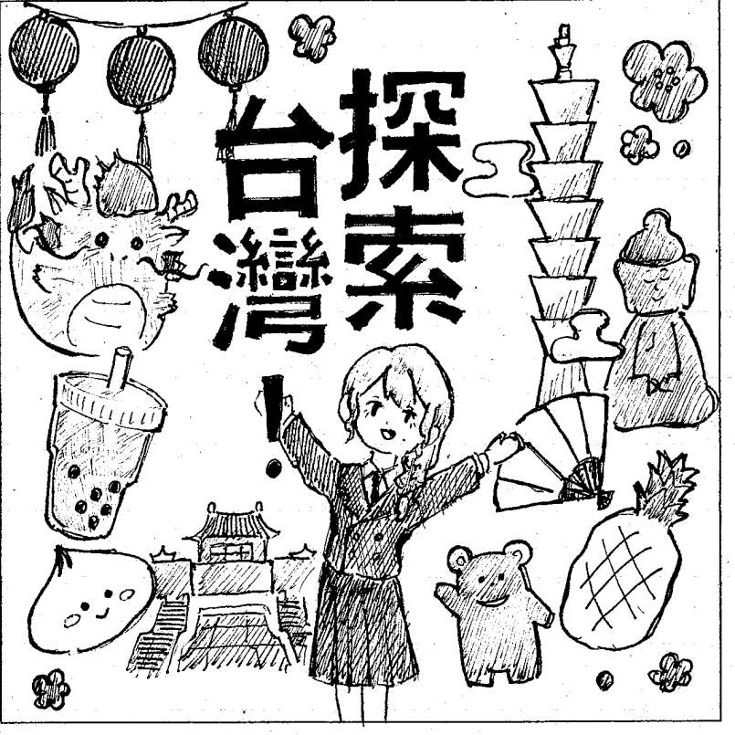
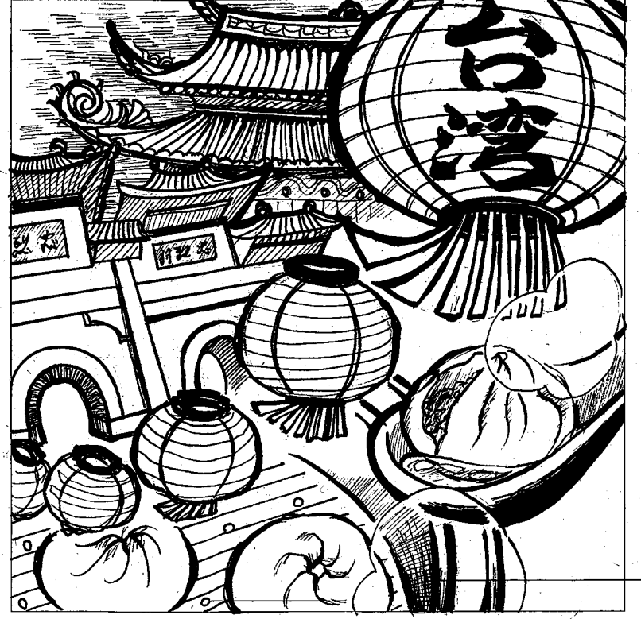
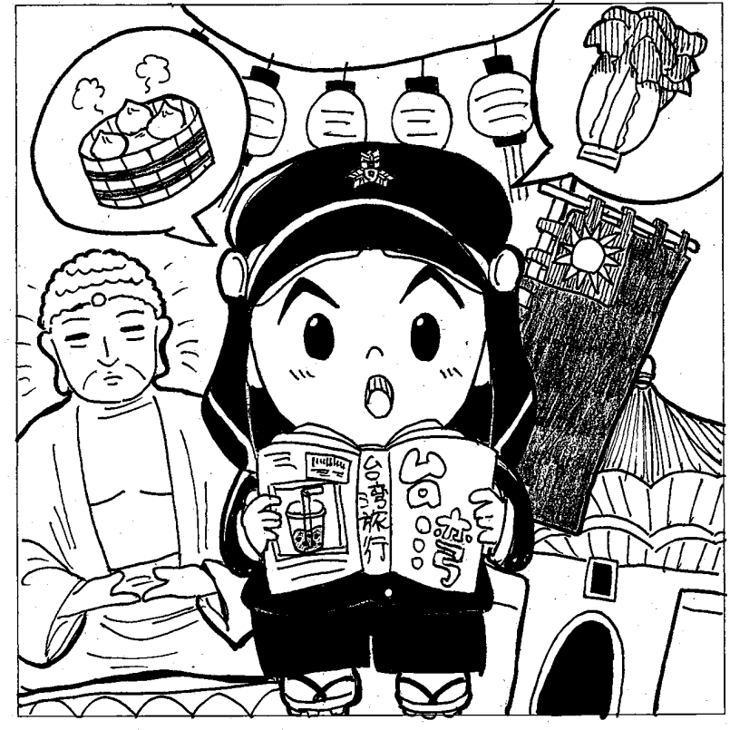
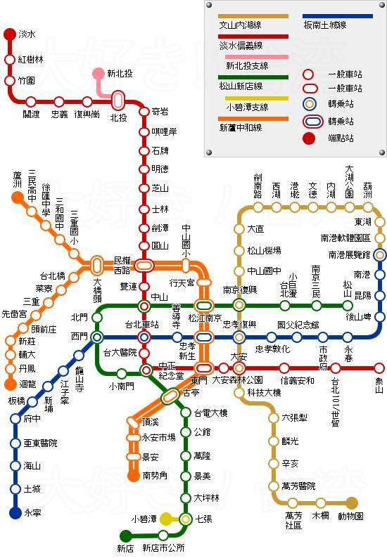
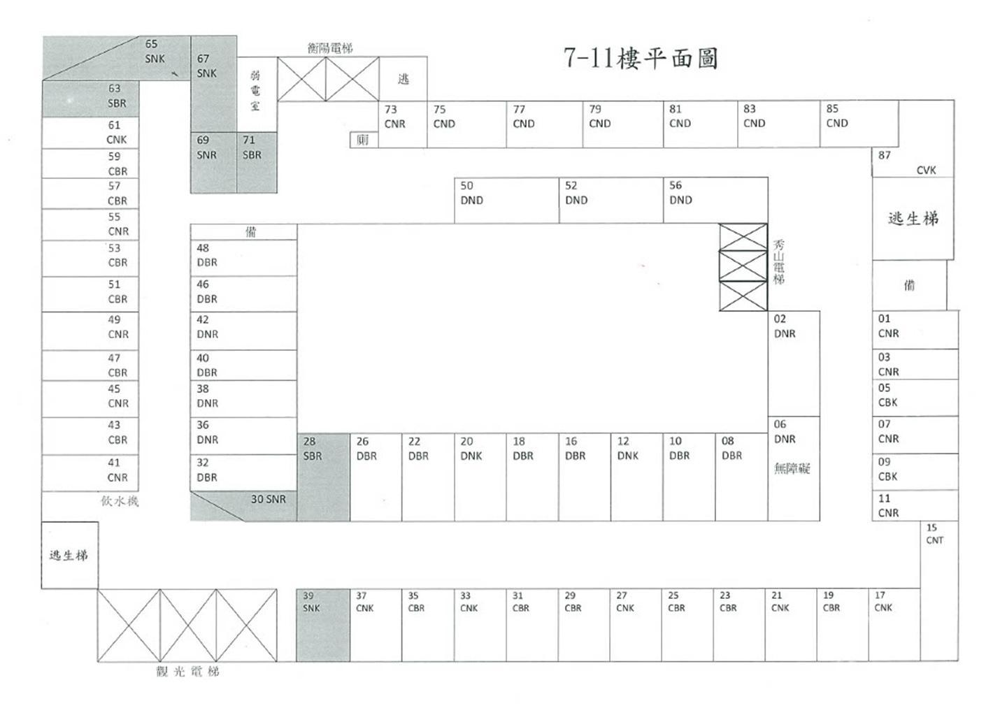

# 令和８（2026）年度 研修旅行のしおり（２年）

**暫定版（2026_1113現在）／鳥取県立鳥取西高等学校**

- 期日：令和８年１２月１日（火）〜４日（金）
- 場所：台湾（台北市）
- 原本：34ページ。[原本PDFを開く](https://drive.google.com/file/d/12cX17qVX1fxJbOhnS4W9hcOlcfBWP1nx/view)

## このMarkdownの扱い（編集上の注記）

- 本文を要約せず、全34ページを順に収録する。改行・空白・表組みをMarkdownに整え、図は原本画像として残す。
- 人名、個人の連絡先・部屋番号、イラスト署名などは公開用のため非掲載とし、その場所を明示する。記入用の空欄は空欄のまま残す。施設・組織の連絡先は原本の記載を残す。
- 「●」「後日連絡」「予定」、原本内の表記・記載の違いを補完・訂正しない。推測・創作・他の資料の情報は本文に加えない。
- 原本p.21の「免税品（腕時計、化粧品等）については購入を禁止する」と、原本p.22の「免税店で買い物可（必要に応じて）」は、双方の記述をそのまま残す。
- 原本p.6の見出し「大荷物用バッグ等（１個）」と、同項の「２個まで無料」は、双方の記述をそのまま残す。
- 原本p.9の番号「④」からp.10の「⑥」への並び、中国語・読み仮名の表記も原本に従う。

## ページ別の参照先

- [表紙](#source-page-1)
- [目次](#source-page-2)
- [はじめに・概要](#source-page-3)
- [バス乗車割当て・引率者の担当](#source-page-4)
- [概略日程](#source-page-5)
- [携行品](#source-page-6)
- [手荷物・大荷物・衣類・スマートフォン](#source-page-7)
- [持参不可の物・液体・モバイルバッテリー](#source-page-8)
- [服装・団体行動](#source-page-9)
- [健康管理・マナー・撮影](#source-page-10)
- [スマートフォン・SNS・宿舎の禁止行為と設備](#source-page-11)
- [宿舎の設備・生活・乗り物酔い](#source-page-12)
- [第1日中表紙](#source-page-13)
- [第1日・学校出発から出国審査](#source-page-14)
- [第1日・搭乗から夕食](#source-page-15)
- [第1日・チェックインと就寝](#source-page-16)
- [第2日中表紙](#source-page-17)
- [第2日詳細](#source-page-18)
- [第3日中表紙](#source-page-19)
- [第3日・朝食から班別研修と定時現況報告](#source-page-20)
- [班別研修・緊急時の対応と注意点](#source-page-21)
- [班別研修・交通安全・費用・禁止事項](#source-page-22)
- [第3日・帰着から就寝](#source-page-23)
- [第4日中表紙](#source-page-24)
- [第4日・起床から保安検査](#source-page-25)
- [第4日・出国審査から学校到着](#source-page-26)
- [班別研修計画書](#source-page-27)
- [各種連絡先・国際電話・連絡依頼文](#source-page-28)
- [参考資料・台北MRT路線図](#source-page-29)
- [部屋番号の記入欄・ホテル見取り図](#source-page-30)
- [禁止事項・台湾の言語](#source-page-31)
- [台湾の言語（続き）・イラスト担当](#source-page-32)
- [メモ](#source-page-33)
- [記名欄](#source-page-34)

---

<!-- source-page:1 -->

<a id="source-page-1"></a>

## 表紙（表紙 / PDF 1ページ）

暫定版（2026_1113現在）

令和８（2026）年度

研修旅行のしおり（２年）

期 日　令和８年１２月１日(火)～４日(金)

場 所　台湾（台北市）

鳥取県立鳥取西高等学校



---

<!-- source-page:2 -->

<a id="source-page-2"></a>

## 目次（原本p.1 / PDF 2ページ）

目 次

### １ はじめに ・・・・・・・・・・・・・・・・・・・ ２

### ２ 概要 ・・・・・・・・・・・・・・・・・ ２～４

### ３ 携行品・服装 ・・・・・・・・・・・・・・ ５～８

### ４ 生活について（注意事項等） ・・・・・・・ ８～１１

### ５ 日程詳細

- （１）第１日 １２／１（火） ・・・・・・・ １２～１５

- （２） 第２日 １２／２（水） ・・・・・・・ １６～１７

- （３）第３日 １２／３（木） ・・・・・・・ １８～２２

- （４） 第４日 １２／４（金） ・・・・・・・ ２３～２５

### ６ その他

- （１） 班別研修計画書 ・・・・・・・・・・・・・・ ２６

- （２）各種連絡先 ・・・・・・・・・・・ ・・・・・ ２７

- （３）参考資料 ・・・・・・・・・・・・・・ ２８～３２

---

<!-- source-page:3 -->

<a id="source-page-3"></a>

## はじめに・概要（原本p.2 / PDF 3ページ）

### １ はじめに

このしおりには 、遵守すべき内容が記載されている。「知らなかった。読んでいなかった。」は通用するものではなく、 著しくルールを守ることができない者 は、指導の対象となり得る ため、注意すること。

#### （１）事前によく読み、内容をよく理解すること。

#### （２） 期間中もよく読み 、正しい行動をすること。

- （３）記載内容は予定であり 、状況により内容に追加や変更が生じることがある。その際には指示を確実に聞き取り 、ボールペン等ですぐにメモをとる こと。

### ２ 概要

#### （１）目的

台湾の歴史を学び、現地を訪問して現在の台湾を直接見聞し、東アジアの未来を志向できる見識を深める。また、集団生活をとおして調和ある人格を形成する。

#### （２）期日 令和８年１２月１日（火）～４日（金）

#### （３）場所 台湾（台北市内及びその周辺）

#### （４） 宿舎

ホテルミッドタウンリチャードソン（徳立荘酒店）

所在地 台北市中正区秀山街 4号

電 話 +886-2-2375-7777

#### （５） 参加者数

- ア 生徒：２７７名（男子１２４名、女子 １５３名）

- イ 教職員：１７名

- ウ 添乗員（JTB 鳥取支店）：４名

---

<!-- source-page:4 -->

<a id="source-page-4"></a>

## バス乗車割当て・引率者の担当（原本p.3 / PDF 4ページ）

### （６）バス乗車割当て

| バス | １号車 | ２号車 | ３号車 | ４号車 | ５号車 | ６号車 | ７号車 |
|---|---|---|---|---|---|---|---|
| 組 | １組 | ２組 | ３組 | ４組 | ５組 | ６組 | ７組 |
| 教職員 | 氏名非掲載 | 氏名非掲載 | 氏名非掲載 | 氏名非掲載 | 氏名非掲載 | 氏名非掲載 | 氏名非掲載 |
| 添乗員 | 1 |  | 1 |  | 1 |  | 1 |
| 男子 | 22 | 19 | 21 | 21 | 17 | 12 | 12 |
| 女子 | 18 | 20 | 19 | 19 | 23 | 26 | 27 |
| 生徒計 | 40 | 39 | 40 | 40 | 40 | 38 | 39 |
| 合計 | 43 | 42 | 43 | 43 | 43 | 41 | 42 |

### （７）引率者及び担当

- 団長：副校長（氏名非掲載）
- 副団長：学年主任（氏名非掲載）
- 総務：（氏名非掲載）
- 生徒指導：（氏名非掲載）
- しおり：（氏名非掲載）
- 事前学習：（氏名非掲載）
- 班別研修：（氏名非掲載）
- 保健･救護：（氏名非掲載）
- 記録：（氏名非掲載）
- パスポート：（氏名非掲載）
- 添乗員：（氏名非掲載）

---

<!-- source-page:5 -->

<a id="source-page-5"></a>

## 概略日程（原本p.4 / PDF 5ページ）

#### （８）概略日程

- ○１２月１日（火）

  - ・学校～関西国際空港【貸切バス】

  - ・関西国際空港～桃園国際空港（機内食あり）【航空機】

  - ・桃園国際空港～夕食会場【貸切バス】

  - ・夕食（聚馥園レストラン・北京料理）

  - ・夕食会場～宿舎【貸切バス】

- ○１２月２日（水）【終日貸切バス】

  - ・朝食（宿舎レストラン）

  - ・研修（中正紀念堂、龍山寺）

  - ・昼食（打狗霸レストラン・鍋料理）

  - ・研修（忠烈祠、国立故宮博物館、総合土産物店）

  - ・夕食（馬來亞レストラン・飲茶料理）

  - ・夕食会場～宿舎

- ○１２月３日（木）

  - ・朝食（宿舎レストラン）

  - ・宿舎～中山堂【徒歩】

  - ・中山堂～班別研修（昼食は各班で）～宿舎

  - ・宿舎～免税店～夕食会場【貸切バス】

  - ・夕食（敘香園レストラン・台湾料理）

  - ・夕食会場～宿舎【貸切バス】

- ○１２月４日（金）

  - ・宿舎発

  - ・桃園国際空港～関西国際空港（機内食あり）

  - ・関西国際空港～学校【貸切バス】

#### （９）その他

- ○研修旅行の時間は『特別活動』（７時間×４日＝２８時間）とする。

---

<!-- source-page:6 -->

<a id="source-page-6"></a>

## 携行品（原本p.5 / PDF 6ページ）

### ３ 携行品・服装

#### （１）携行品

- ①パスポート【 重要・肌身離さず、常に所在に配慮 】

- ○パスポートケース使用可。

- ○紛失、盗難等に要注意。

- ○出発時の携行失念は研修旅行不参加となる。

- ○台湾滞在中は、宿舎各室のセキュリティBOX で管理。

- ②腕時計（時間厳守の必需品として ）

- ○スマートフォンで都度確認しない 。

- ③筆記用具

- ④しおり

- ⑤現金（自主研修時の交通費・昼食代、お土産代等）

- ○両替について（円から台湾ドルへ・ 5,000円単位にて）

  - ・事前申請したものに ついて対応する

  - ・現地到着後の貸切バス車内で行う予定

  - ・帰国時に再両替の対応は無いため、現地で使い切ること

- ⑥パスポートの写し（コピー）

- ⑦ハンカチ、ポケットティッシュ

- ⑧マスク（機内や車内での着用を 推奨する ）

- ⑨ナイロン袋（ごみ入れ）

- ⑩雨具（折りたたみ傘、合羽等）

- ⑪往路のバス内での 軽食等（ ただし 食べきる こと）

- ○（参考） 往路の機内食は 14:00頃の予定

- ⑫洗面用具

- ⑬アイケア用品（コンタクトレンズ保存液、眼鏡等）（該当者）

- ⑭常備薬（該当者）

- ○説明書の写しをしおりの予備ページに貼付けのこと。

- ⑮保険証書（任意保険に加入した者）

- ⑯ガイド本又はその写し（必要に応じて）

- ⑰デジタルカメラ（必要に応じて）

- ⑱手荷物 用バッグ等 （１個）

---

<!-- source-page:7 -->

<a id="source-page-7"></a>

## 手荷物・大荷物・衣類・スマートフォン（原本p.6 / PDF 7ページ）

- ○リュックサック、トートバック等。（横36cm＋縦 23cm＋高さ56cm以内で３辺の合計が 115cm以内、重さ 荷物込みで 7kg以内、１個）

- ○航空機内やバス内に持ち込 んだり、研修時に携行したりするものとして使用。

- ○特に自主研修時で使用する際は、スリ、置き引き、紛失等に留意する。（自己責任）

- ⑲大荷物用バッグ等（１個）

- ○スーツケース等の大型バッグ等。（縦＋横＋高さの長さの和が158cm以内、重さは１つあたり荷物込みで23kg以内、２個まで無料）

- ○手荷物以外の荷物 用として使用。（鍵付きが望ましい ）

- ○空路においては、 出発時の搭乗手続き時に預け、到着時に受け取る。

- ○バス乗車時はトランクルームに積み込む 。

- ○宿舎の客室に置いて外出する場合は、荷物を入れて鍵をかけること 。（紛失等防止のため）

- ○お土産等はこの中に入れるため、余裕を持たせておく 。

- ○ツアー専用荷札（事前に配布予定）を常時取り付けておく 。（クラスにより色が異なる）

- ⑳衣類【注意事項は P.●参照】

- ○制服（移動・研修用、 替えのカッターシャツ含む）

- ○宿舎用の服（華美でなく、露出の少ないもの）

  - ・館内着（ Tシャツ ・ジャージ ・スウェット等）

  - ・就寝 用（パジャマ等）

- ○肌着、靴下等

- ㉑その他

- ○スマートフォン 等を持参する 場合

  - ・期間中は機内モードにしておく 。（通信機能不可）

  - ・カメラ機能 についてのみ使用可。（ただし、教職員が認めた場面において ）

---

<!-- source-page:8 -->

<a id="source-page-8"></a>

## 持参不可の物・液体・モバイルバッテリー（原本p.7 / PDF 8ページ）

  - ・機内では必ず電源は OFFにする。

  - ・通信等により料金が発生した場合 は全て自己負担とする 。（自己責任）

- ○モバイルバッテリー を持参する場合

  - ・必ず 機内に持ち込み 、手元で保管 。（大荷物内 不可）

#### （２）注意すべき物

#### ≪持参不可≫

- ○研修の趣旨に反する物（ゲーム、漫画等）

- ○可燃性及び引火性物質（花火、マッチ、クラッカー等）

- ○高圧ガス類（制汗スプレー、ヘアスプレー・ムース等）

- ○検疫において基準を満たさない物（果物等）

- ○バッテリー式ヘアアイロン（手荷物・大荷物ともに不可）

#### ≪大荷物内ならば持参可能（手荷物内は不可） ≫

- ○一部刃物類（カミソリ、はさみ、爪切り等）

- ○100㎖を超える容器入りの液体（コンタクト レンズ保存液、飲料、歯磨き粉、ヘアワックス等）

- ＜補足＞

  - ・100㎖以下の個々の容器で、それを１ℓ以下のジッパー付き無色透明プラスチック袋に余裕をもって入れ 、一人１個（１袋）まで、 手荷物 として機内に持ち込み 可能。

  - ・搭乗ゲート到着後に購入した飲料は、機内に 持ち込み可能。

  - ・飲料等が不足することが不安な者は、大荷物に入れて持っていくとよい 。

#### ≪機内にて手元に保管ならば持参可能（大荷物内は禁止）≫

- ○モバイルバッテリー

  - ・ワット時定格量が 160Whを超えるものは機内持ち込み 禁止。（没収され る）

  - ・一人２個まで持ち込み可能。

  - ・収納棚に収納しない。

  - ・ワット時定格量 の記載がない 製品は持ち込みできない場合がある。

---

<!-- source-page:9 -->

<a id="source-page-9"></a>

## 服装・団体行動（原本p.8 / PDF 9ページ）

#### （３）服装

#### ≪宿舎外≫

- ○制服（平素の学校生活と同様、正しく着用）

#### ≪宿舎内≫

- ○館内着（Tシャツ、ジャージ、スウェット等）

  - ・華美でなく、露出の少ないもの。

- ○就寝用（必要に応じて準備、館内着で寝ても問題はない ）

- ○朝食時、就寝用服装は不可（制服可）

  - ・部屋から一歩出れば公道と同じ

#### ≪その他≫

- ○１２月の台湾の気候は比較的温暖であるが、体温調節に心がける。

- ○マスク について、 機内や車内での着用を推奨する 。

### ４ 生活について（注意事項等）

#### （１）団体行動であることを 念頭に置く

- ①研修旅行 は、友達同士や家族 との旅行ではない。 引率教職員や添乗員さん の指示を忠実に守って 行動する こと。（勝手な判断をしない。）

- ②期間中は何度も点呼 を行う機会がある 。集合時刻の５分前には必ず整列完了し 、すぐに点呼ができるようにする。トイレ等も混雑 に巻き込まれないように早めに 済ませる。

- ③集合時 、各責任者は 正確な点呼を行い 、担当教職員に報告する。点呼の間違い は厳禁である 。

- ④トイレ等も含め 、単独行動は 絶対にしない。

- ⑤研修等において 、万一はぐれてしまった場合には 、慌てずに 担任又は本部に連絡し て指示に従 う。（P.27参照。）

- ⑥不測の事態が生じた場合は 、いかなる場合においても、直ちに引率教職員に伝える 。

---

<!-- source-page:10 -->

<a id="source-page-10"></a>

## 健康管理・マナー・撮影（原本p.9 / PDF 10ページ）

#### （２）健康管理に万全を期す

#### ≪研修旅行前≫

- ①持病のある者や 治療中の者は 、事前に受診し主治医の指示に従う。必要に応じ て、英文の指示書を 作成して もらい 、研修旅行に持参する。

- ②体内にボルト等 による処置が ある等、空港の 保安検査 で止められそうな者は 、主治医と相談し 、英文の説明書を準備・持参する。

- ③常備薬及び説明書（しおり に貼付）を準備する。薬の貸借 は不可。

- ④出発日の朝、体調不良者は、朝 5:30～6:00までに公用携帯電話（番号は公開用のため非掲載。原本で確認）に必ず連絡し、指示を受ける。

#### ≪研修旅行中≫

- ①三度の食事をきちんと 摂る。（間食をし過ぎない ）

- ②早めに就寝する。（ 睡眠不足は判断力低下や怪我につながる ）

- ③体調 が悪くなった者は 、直ちに引率教職員 に申し出る。

- ④手洗い 、うがいを心 がける。

- ⑤食中毒予防のため 、班別研修（３日目） において 、屋台等で埃等がかかり得る状態で 販売してい る飲食物 の購入は控える 。特に体調に不安のあるものは留意する。

#### （３）マナーの遵守及び危機管理について

- ①機内で騒ぐなど 、他の旅客に迷惑をかけ ない。（貸切ではない）

- ②宿舎外において は、学校生活と同様 に制服を正しく 着用する。

- ③バス運転手や 宿舎従業員 等、関係者の方々に挨拶を する。

- ④スマートフォン 等の取扱いについては 次の通りとする。

- ア 研修旅行は教育活動 の一環 であり、原則学校 生活と同じ取扱いとする。

- イ 教職員が認めた場合において 、カメラ機能を使用することができる。

- ウ 無断で人を撮影しない 。

- エ 自撮り棒等の道具は使用しない。

---

<!-- source-page:11 -->

<a id="source-page-11"></a>

## スマートフォン・SNS・宿舎の禁止行為と設備（原本p.10 / PDF 11ページ）

- オ 撮影禁止の場所では絶対に撮影をしてはならない。また、フラッシュ撮影禁止の場所では その指示に従う こと。

- カ 期間中は 、機内モードにしておく。（機内 では電源 OFF）通信機能は使用 不可。万が一、通信等により料金が 発生した場合は、全て自己 負担とする。（自己責任）

- ⑥パスポートや貴重品 の紛失等が無いよう留意する 。カメラ 等について見知らぬ 観光客等に渡さない。 （紛失等は全て 自己責任）

- ⑦撮影した写真をＳＮＳ上に 掲載することは固く禁ずる 。（他者が映り込んでいる 等の場合、大問題になり得る。）

#### （４）宿舎での生活について

貸切ではない。同じフロアに一般客が宿泊している場合もある。マナーを 遵守し 、絶対に迷惑をかけない。

#### ≪禁止行為 ≫次の行為は 固く禁止する 。

- × 別階のフロア 、客室を行き来すること。 （特に男女間 ）

- × 点呼を受けた後に部屋から出ること。

- × ロビー、廊下、エレベーター等で騒ぐこと。

- × 宿舎から外出すること。

- × ゲーム等で遊んだり漫画を読んだりすること。

- × その他、研修の趣旨に反する不適切な行動をとること。

#### ≪設備等 について≫

- ①チェックイン後 すぐ、非常口 （FIRE EXITS）・避難経路を確認する。（ 火災発生 時は、着替えずに速やかに避難する。 ）

- ②エレベーターは ６機ある。ルームキーがなければ客室階へは行けない。客室階の階段は非常時を除き使用 禁止。

- ③全客室にセキュリティ BOXがある。パスポートは チェックイン時からチェックアウト時 まで、各客室のセキュリティ BOXで管理する。（自己管理）（他の貴重品管理 にも利用可能。チェックアウト時に置き忘れないこと。）

- ④水道水は絶対に飲ま ない。

---

<!-- source-page:12 -->

<a id="source-page-12"></a>

## 宿舎の設備・生活・乗り物酔い（原本p.11 / PDF 12ページ）

- ⑤台湾全域において、トイレ使用後に一度に流れる水量が少ない。日本のように多くのペーパーを一度に流すと詰まってしまう。

- ⑥バスタオル 、フェイスタオル 、シャンプー 、ボディソープ 、ドライヤー等は 客室内に備付けの物を使用 できる 。

- ⑦客室内に備付け の電話は使用禁止（内線・外線とも）。（ただし、 ４日目朝のみ 、起床報告がなく 、ノックにも反応がない部屋に対して 、班長の内線 使用を許可する 場合がある 。）

- ⑧パジャマ姿や 客室内備付けのスリッパを履いて 、客室から出ない。

- ⑨朝は起床時刻 頃に合わせて 、全室モーニングコールが掛かる。

- ⑩スマホ等の充電器 について 、日本で使用している 物をそのまま使用できる 場合が多いが 、海外対応 可能か否か 、各自確認すること。

- ⑪宿舎フロント での両替はできない。

- ⑫朝食時や宿舎出発時等 、客室を出る際は 、必ず生活班で行動する。

- ⑬朝食時や宿舎出発時は、クラスご とにエレベーターの 使用時間を指定する 。（混雑緩和のため 厳守。）

- ⑭朝食会場は ●階●● である。

#### （５） 乗り物酔いの予防

- ①十分な睡眠をとって 、体調を整える。

- ②頭を動かさずに進行方向を見る。

- ③酔い止め薬は乗車の３０分前には 服用する 。

- ④「自分は酔わない」と自己暗示をかける。

- ⑤乗り物酔いに効くつぼ（内関）を押す。

- ⑥もしもの 場合は、バスや飛行機の座席にある エチケット袋を使用する。

---

<!-- source-page:13 -->

<a id="source-page-13"></a>

## 第1日中表紙（原本p.12 / PDF 13ページ）

### ５ 日程詳細

第１日１２／１（火）



---

<!-- source-page:14 -->

<a id="source-page-14"></a>

## 第1日・学校出発から出国審査（原本p.13 / PDF 14ページ）

#### （１）第１日：１２月１日（火）

##### 6:00 貸切バス乗車開始（車内にトイレ無し）

- ○トランクルームへ大荷物積込み（手荷物は車内へ）

- ○乗車時にパスポート所持確認【教職員が必ず行う】（パスポートは以後各自で管理）

- ○点呼

##### 6:30 学校発【貸切バス】

- ○途中乗車：河原 ICバス停（●:●●）（時間は目安）

- ○途中●回トイレ休憩 予定（都度バスポート所持確認）

- ○持参した飲食物は空港到着までに全て 完食等する（機内には持ち込めない）

##### 10:30 関西国際空港着（詳細は P.●参照）

- ○貸切バスから 荷物を下ろし、搭乗券を受取る

- ○クラス毎に空港内へ （担任先頭、副担任最後尾）

- ○チェックイン カウンターへ 移動（クラス毎）

  - ・1～4 組⇒チャイナエアライン（China Airlines/中華航空）【CI157便】

  - ・5～7組⇒エバー航空（EVA Air/長栄航空）【BR131便】

- ○搭乗手続き（無人化されている場合あり）

  - ・パスポート と搭乗券を見せ 、大荷物を預ける

- ○保安検査

  - ・ベルト（外す）、電子機器（スマホ等） 手荷物、制服上着、ポケット内の物

- ⇒全てカゴに入れ、ボディチェックゲートを 通過（ゲート通過後、荷物を受け取る）

- ○出国審査

  - ・マスクを外す （着用者）

  - ・パスポートと搭乗券を見せ、カメラに顔を向ける

---

<!-- source-page:15 -->

<a id="source-page-15"></a>

## 第1日・搭乗から夕食（原本p.14 / PDF 15ページ）

- ○搭乗口へ移動

  - ・搭乗口の番号を案内表示で確認、移動（場所によってはウイングシャトルにて移動）

- ○搭乗口到着

  - ・到着、点呼、トイレ休憩等

  - ・集合、再点呼、搭乗（案内アナウンス順に）（パスポート、搭乗券）

##### 12:45 1～4組：関西国際空港発【 CI157便】

##### 12:55 5～7組：関西国際空港発【 BR131便】

- ○フライト（約３時間）

  - ・機内食あり（それまでに空腹が予想される場合は各自で準備し対応）～ここから現地時間（日本時間のマイナス１時間）～

##### 15:00 1～4 組：桃園国際空港着【CI157 便】

##### 15:05 5～7組：桃園国際空港着【 BR131便】

- ○降機、入国審査

  - ・審査カウンターへ移動（クラス毎）

  - ・マスクを外す（着用者）

  - ・パスポート を見せ、カメラに顔を向ける

- ○荷物受取所へ移動 （受取所は案内表示で確認）

  - ・荷物受取り（自クラスの荷札の付いた荷物は全て）

- ○ロビー集合 、点呼（適宜トイレ休憩）

- ○貸切バス乗車、点呼

##### 16:30 桃園国際空港発【貸切バス】（夕食会場へ）

##### 17:30 夕食『聚馥園レストラン』（ 北京料理）

- ○貴重品のみ持つ、自クラスの席へ

- ○食事終了後、貸切バスにて宿舎へ 、車内にて諸連絡

  - ・チェックインの方法

  - ・パスポートの管理方法

  - ・翌日の行動計画

  - ・点呼について 等 （必要に応じてメモをとる）

---

<!-- source-page:16 -->

<a id="source-page-16"></a>

## 第1日・チェックインと就寝（原本p.15 / PDF 16ページ）

##### 19:00 宿舎着、チェックイン

- ○ルームキー配布、 エレベーターで客室へ

- ○手洗い、うがい

- ○パスポートを客室内の金庫に保管 【重要・必須】

- ○自室からの非常口、避難経路の確認 【重要・必須】

##### 21:00 点呼・健康チェック

- ○生活班班長の部屋 に班員集合（班ごとに実施）

- ○終了後自室へ戻る（以降は自室から出ない）就寝（翌日以降に備えて早く寝る）

---

<!-- source-page:17 -->

<a id="source-page-17"></a>

## 第2日中表紙（原本p.16 / PDF 17ページ）

第２日１２／２（水）



---

<!-- source-page:18 -->

<a id="source-page-18"></a>

## 第2日詳細（原本p.17 / PDF 18ページ）

#### （２）第２日：１２月２日（水）

##### 6:00 起床

##### 6:30～点呼・健康チェック、朝食

- ○生活班全員が揃って 朝食会場へ（●階／●● ）

  - ・混雑回避のためクラスごとに 時間を分ける

#### ≪エレベーター 使用≫

5･6･7組 ⇒ 6:20 以降3･4組 ⇒ 6:30以降1･2組 ⇒ 6:40以降

- ○生活班ごとに 点呼・健康チェック （担任）5･6･7組 ⇒ 6:30 3･4組 ⇒ 6:40 1･2組 ⇒ 6:50

- ○朝食（ビュッフェ形式）

- ○朝食が終わった生活班から随時自室へ（出発準備）

##### 8:30 宿舎発【貸切バス・クラスごと】研修・見学（詳細は都度連絡）

- ○1～4 組：中正紀念堂（9:00）、龍山寺（10:30）

- ○5～7 組：龍山寺（9:00）、中正紀念堂（10:00）

##### 12:30 昼食『打狗霸レストラン 』（鍋料理 ）研修・見学（次をローテーション） （詳細は都度連絡）忠烈祠、国立故宮博物館、総合土産物店にて買い物可

##### 18:30 夕食『馬來亞レストラン』（ 飲茶料理）

- ○貴重品のみ持つ、自クラスの席へ

- ○食事終了後、貸切バスにて宿舎へ、車内にて諸連絡

  - ・翌日の行動計画 、点呼について等

##### 20:00 宿舎着

- ○手洗い ・うがい、パスポート確認（客室内金庫 ）

##### 22:00 点呼・健康チェック（前日と同様のかたちで行う）就寝（翌日以降に備えて早く寝る）

---

<!-- source-page:19 -->

<a id="source-page-19"></a>

## 第3日中表紙（原本p.18 / PDF 19ページ）

第３日１２／３（木）



---

<!-- source-page:20 -->

<a id="source-page-20"></a>

## 第3日・朝食から班別研修と定時現況報告（原本p.19 / PDF 20ページ）

#### （３）第３日：１２月３日（木）

##### 6:00 起床

##### 6:30 点呼・健康チェック、朝食

- ○生活班全員が揃って 朝食会場へ（●階／●● ）

  - ・混雑回避のためクラスごとに 時間を分ける

#### ≪エレベーター 使用≫

3･4組 ⇒ 6:20以降1･2組 ⇒ 6:30以降5･6･7組 ⇒ 6:40以降

- ○生活班ごとに 点呼・健康チェック （担任）3･4組 ⇒ 6:30 1･2組 ⇒ 6:40 5･6･7組 ⇒ 6:50

- ○朝食（ビュッフェ形式）

- ○朝食が終わった生活班から随時自室へ（出発準備）

##### 8:40 点呼、宿舎発【徒歩】（クラスごとに中山堂へ）中山堂集合

- ○点呼、諸連絡

- ○現地学生（B&S）と合流（対面式）

  - ・班員全員で挨拶（班長がリード）

  - ・現地学生自己紹介（名前、携帯電話番号をメモ）

  - ・班員自己紹介（はっきりと伝える）

  - ・日程及び留意点等の確認（体調不良等配慮が必要な場合は現地学生 と共有）

##### 9:00 班別研修出発（対面式が終わった班から随時）

#### ◎次ページからの『緊急時の対応』『班別研修の注意

点』を必読のこと

##### 12:00～13:00定時現況報告【重要・必須】

- ○現地学生の携帯電話を借り て担任へ連絡（班長）

  - ・班、班長名、現況（どこで何を している等 ）等

---

<!-- source-page:21 -->

<a id="source-page-21"></a>

## 班別研修・緊急時の対応と注意点（原本p.20 / PDF 21ページ）

#### ≪緊急時の対応≫

- ●緊急事態発生時（班員行方不明、事故、体調不良等）

  - ・班長（または班員）が速やかに現地学生へ伝え、現地学生の指示に従う。

  - ・現地学生は必要に応じて本部 へ連絡し対応を協議。

  - ・その際班長（または班員）が電話で事情を説明する 場合あり。（事態を的確に把握、説明 ）

- ●自身が現地学生とはぐれた場合

  - ・しおりの最終ページの 『連絡依頼』を確認

  - ・「私は道に迷いました。 (後略)」を利用し、近くの 人（店員等）に依頼し、現地学生の携帯電話番号を指さして、

電話をかけてもらう。

  - ・電話が 繋がったら、現地学生 の「現在地」をたずねる。（分からなければ、電話を依頼した人 と交代する等して、場所を伝えてもらう等するとよい。）

- ⇒大切なことは、冷静に落ち着いて対応すること 。

  - ・原則としてその場から遠くへ動かない方がよい。

  - ・現地学生に繋がらない場合、本部携帯 番号等を指さして、電話をかけてもらう。

- ⇒いずれの場合も、報告・連絡・相談を速やかに行うこと。

  - ・問題が解決した場合は、本部に報告を速やかに入れる 。

#### ≪班別研修の注意点≫

- ●帰着時刻の厳守（16:30～17:00に宿舎）（ただし、自主研修の意義上、16:30 より早い帰着は不可）

- ●各班の『計画表』に従って行動する。

  - ・帰着時刻に遅れる可能性があれば予定を切り上げ る。

  - ・現地学生の指示をよく 聴き、守ること。

- ⇒ただし、現地学生はガイドではない。依存するのではなく、自分たちでコース、交通手段など把握しておく。地図を必ず持参。不明な点は遠慮 なく確認し合う。

---

<!-- source-page:22 -->

<a id="source-page-22"></a>

## 班別研修・交通安全・費用・禁止事項（原本p.21 / PDF 22ページ）

- ●見学、散策、食事、買い物等に加え、現地学生と班員全員でコミュニケーションを取り合い、有意義な研修を実施する。

- ●単独行動は厳禁 とする（全行程において（ トイレ時含む））

- ●交通安全には十二分に留意する。

  - ・横断歩道 について、信号が青になったことを確認 してから渡る。（見切り発進厳禁、 周囲の車両を確認）

- ⇒台北市内は 車両（車、バイク）が非常に多い。横断歩道の信号が青になっても、車両の動きをよく確認してから渡る。突っ込んでくる 車両もあり得る。

  - ・台湾では、車両は右 側通行。

- ●スリや置き引き、貴重品の紛失等に十分に気をつける。

  - ・ファストフードの注文等 において も、座席に荷物を置いたまま離れない。

- ●地下鉄の切符、施設入場 券等は全て自分たちで購入する。

- ●現地学生にかかる料金は班員で 等分負担する。

- ●原則、タクシー での移動は避ける。（２台に分乗したタクシーがはぐれた場合、運転手と言葉が通じず合流できなくなる可能性が高い。）

- ●地下鉄の構内・車両内、路線バス内等は飲食厳禁。（ガムも禁止。多額の罰金が 科せられる。）

- ●免税品（腕時計、化粧品等）については購入を禁止する。（翌朝の桃園国際空港内で 保安検査 等が混み合う可能性が大きく、受け取る時間が保障できないため。）

---

<!-- source-page:23 -->

<a id="source-page-23"></a>

## 第3日・帰着から就寝（原本p.22 / PDF 23ページ）

##### 16:30～17:00宿舎帰着、帰着報告・点呼

- ○すみやかに帰着報告を行う。

- ○次の貸切バス乗車開始時刻まで 宿舎自室で待機。

##### 17:30 点呼、宿舎出発【貸切バス】

##### 17:50 免税店で買い物可（必要に応じて）

##### 19:00 夕食『敘香園レストラン』（台湾料理）

- ○貴重品のみ持つ、自クラスの席へ

- ○食事終了後、貸切バスにて宿舎へ、車内にて諸連絡

  - ・翌日の行動計画、点呼について等

##### 20:30 宿舎着

- ○手洗い・うがい、パスポート確認（客室内金庫）

##### 22:00 点呼・健康チェック

- ○前日と同様のかたちで行う（ただし、パスポートの確認を行う）荷物整理【重要】就寝（翌朝 4:00起床に備えて早く寝る）

---

<!-- source-page:24 -->

<a id="source-page-24"></a>

## 第4日中表紙（原本p.23 / PDF 24ページ）

第４日１２／４（金）



---

<!-- source-page:25 -->

<a id="source-page-25"></a>

## 第4日・起床から保安検査（原本p.24 / PDF 25ページ）

#### （４）第４日：１２月４日（金）

##### 4:00 起床部屋ごとに 生活班班長へ起床報告 （4:15までに）

- ○報告が無い場合、班長は内線又はノック等により確実に確認を行う。【重要】

- ○それでも確認がとれない場合は教職員へ連絡。荷物確認（パスポート ⇒手荷物内に 入れる）チェックアウト朝食（弁当）受取り（ロビー 予定）

##### 4:40 貸切バス乗車開始

##### 5:00 点呼、宿舎発【貸切バス】（空港へ）

##### 5:30 桃園国際空港着

- ○貸切バスから荷物を下ろし、搭乗券を受取る

- ○クラス毎に空港内へ（担任先頭、副担任最後尾）

- ○チェックインカウンターへ移動（クラス毎）

  - ・1～4組⇒チャイナエアライン（China Airlines/中華航空）【CI156便】

  - ・5～7組⇒エバー航空（EVA Air/長栄航空）【BR132便】

- ○搭乗手続き（無人化されている場合あり）

  - ・パスポートと搭乗券を見せ、大荷物を預ける

  - ・大荷物が検査をクリアしたかをモニターで確認

- ⇒クリアしなければ日本に届かない（台湾のチェックは日本より厳しい）

  - ・待ち時間 中のトイレは近くのトイレ を利用

- ○保安検査

  - ・ベルト（外す）、電子機器（スマホ等）手荷物、制服上着、ポケット内の物

- ⇒全てカゴに入れ、ボディチェックゲートを通過（ゲート通過後、荷物を受け取る）

---

<!-- source-page:26 -->

<a id="source-page-26"></a>

## 第4日・出国審査から学校到着（原本p.25 / PDF 26ページ）

- ○出国審査

  - ・マスクを外す（着用者）

  - ・パスポートと搭乗券を見せ、カメラに顔を向ける

  - ・両手人差し指を機械にかざすよう指示される場合あり

- ○搭乗口へ移動

  - ・搭乗口の番号を案内表示で確認、移動

- ○搭乗口到着

  - ・到着、点呼、トイレ休憩等

  - ・集合、再点呼、搭乗（指示順に）（パスポート、搭乗券）

##### 8:05 桃園国際空港発【CI156 便：1～4 組】

##### 8:20 桃園国際空港発【 BR132便：5～7組】

- ○フライト（約３時間３０分 、機内食あり ）～ここから日本時間～

##### 11:35 関西国際空港着【 CI156便：1～4組】

##### 11:55 関西国際空港着【BR132 便：5～7 組】

- ○降機、 入国審査

  - ・審査カウンターへ移動（クラス毎）

  - ・マスクを外す（着用者）

  - ・パスポートを見せ、 カメラに顔を向ける

- ○荷物受取所へ移動（受取所は案内表示で確認）

  - ・荷物受取り（自クラスの荷札の付いた荷物は全て）

- ○ロビー集合 、点呼（適宜トイレ休憩）

- ○貸切バス乗車、点呼

##### 13:30 関西国際空港発【貸切バス】

- ○途中●回トイレ休憩 予定

- ○希望者のみ軽食購入の場を設ける場合あり

- ○途中下車：用瀬 PA、河原 ICバス停、鳥取駅南口

##### 17:30 学校着（予定）、解散

---

<!-- source-page:27 -->

<a id="source-page-27"></a>

## 班別研修計画書（原本p.26 / PDF 27ページ）

### ６ その他

#### （１）班別研修計画書（２年　組　班）

- ○班長：（　　　　　　　　　）
- ○副班長：（　　　　　　　　　）
- ○班員：（　　　　　　　　　）（　　　　　　　　　）（　　　　　　　　　）（　　　　　　　　　）
○行程（原本の空欄・矢印を保持）

```text
   中山堂           9:00                       ：
     ↓       手段                ↓        手段
                  ：                         ：
     ↓       手段                ↓        手段
                  ：                         ：
     ↓       手段                ↓        手段
                  ：                         ：
     ↓       手段                ↓            徒歩
                  ：          宿舎帰着       16:30～17:00
     ↓       手段                点呼
```

- ●定時現況報告（12:00〜13:00）
  - 班長（現地学生の携帯電話を借りて）→担任携帯電話
- ●事故時
  - 緊急事態発生時（班員行方不明や事故・体調不良等）：現地学生（または班長／班員）→本部携帯電話
  - 現地学生とはぐれた場合：「道に迷いました」を利用し，現地学生の携帯電話に連絡する。繋がらない場合は「道に迷いました」を利用して本部携帯電話に連絡する。

---

<!-- source-page:28 -->

<a id="source-page-28"></a>

## 各種連絡先・国際電話・連絡依頼文（原本p.27 / PDF 28ページ）

### （２）各種連絡先（研修旅行時）

#### ◎日本国内同士

（出発日の緊急連絡は5:30〜6:00に公用携帯へ）

- 鳥取西高校公用携帯：［公開用のため番号非掲載。原本で確認］
- 鳥取西高校：０８５７－２２－８２８１
- （株）ＪＴＢ鳥取支店：０８５７－２２－８８５１

#### ◎台湾国内同士

| 区分 | 担当 | 連絡先 |
|---|---|---|
| 本部 | 副校長（団長）・氏名非掲載 | 後日連絡 |
| 本部 | 学年主任（総務）・氏名非掲載 | 後日連絡 |
| 本部 | 養護教諭（救護）・氏名非掲載 | 後日連絡 |
| 担任 | 氏名非掲載 | 後日連絡 |
| 現地学生 | 氏名非掲載 | 後日連絡 |

#### ◎日本携帯 → 台湾（できるだけ携帯電話でお願いします）

010 + 886 + 相手の番号（最初の0はとる）

#### ◎台湾 → 日本

002 + 81 + 相手の番号（最初の0はとる）

（例）鳥取西高校：００２－８１－８５７－２２－８２８１

#### ◎迷子になった場合『私は道に迷いました。』

我迷路了。這是我的老師的電話。請幫我打電話到這是電話。

≪日本語訳≫

私は道に迷いました。この番号は私の先生の電話です。この電話にかけるお手伝いをお願いします。（電話番号を指差す）

---

<!-- source-page:29 -->

<a id="source-page-29"></a>

## 参考資料・台北MRT路線図（原本p.28 / PDF 29ページ）

#### （３）参考資料

#### ◎台北ＭＲＴ路線図（詳細は各自で確認）



---

<!-- source-page:30 -->

<a id="source-page-30"></a>

## 部屋番号の記入欄・ホテル見取り図（原本p.29 / PDF 30ページ）

### ◎生活班の部屋番号

| 部屋番号（空欄） | 原本の氏名記入欄（空欄） |
|---|---|
| 　　　　　号室 | 生活班（◎班長）（私　）（　　　　　）（　　　　　） |
| 　　　　　号室 | （　　　　　）（　　　　　）（　　　　　） |
| 　　　　　号室 | （　　　　　）（　　　　　）（　　　　　） |
| 　　　　　号室 | （　　　　　）（　　　　　）（　　　　　） |

### ◎引率教職員の部屋番号（後日連絡）

［個人の部屋番号・氏名は公開用のため掲載しない。原本に記入欄あり］

### ◎ホテル見取り図



---

<!-- source-page:31 -->

<a id="source-page-31"></a>

## 禁止事項・台湾の言語（原本p.30 / PDF 31ページ）

#### ◎禁止事項

- × 別フロアの部屋に移動すること。

- × 点呼を受けた後に部屋から出ること。

- × ロビー、廊下、エレベーター等で騒ぐこと。

- × ホテルから外出すること。

- × ゲームや漫画等で遊ぶこと。飲酒や喫煙等。

- × その他、研修中の行為として不適切な行動をとること。

- △ 階段は緊急避難用であり、通常の使用はホテルから禁止されている。緊急時以外の使用は 禁止。

#### ◎台湾の言語「指さし    10ヵ国語旅行会話」（ストーク）より

- 私： 我 ウォ 日本人： 日本人 リーベンレン

- あなた： 你 ニー ～が好き： 喜欢 シーホワン

- こんにちは： 你好 ニーハオ

- お元気ですか？： 你好吗？ ニーハオマ

- さようなら： 再见 ザイジェン

- ありがとう： 谢谢 シェーシェ

- どういたしまして： 不客气 ブクァチ

- はい、いいえ： 是的、不是 シーダ、ブーシー

- ちょっとすみません： 对不起 ドェブチー

- おいしかったです： 真好吃！ ジェンハオチー

- トイレ(駅)はどこですか？： 厕所（车站）在哪里？ ツースォ(チャージャン)ザイナーリ

---

<!-- source-page:32 -->

<a id="source-page-32"></a>

## 台湾の言語（続き）・イラスト担当（原本p.31 / PDF 32ページ）

- おすすめは？： 您推荐点儿什么？ ニントェイジェンデンアールシェンマ

- いくらですか？： 多少钱 ドゥオシャオチェン

- 高いです、もっと安くして： 太贵了、便宜一点儿吧 タイグイラ、ピエンイーイーデンアールバ

- どうぞお願い： 请拜托 チンバイトォー

- 返品したいのですが： 我相退掉这件商品 ウォシャントゥイディアオジャージェンシャンピン

- ★自分で調べた決めゼリフ

#### ◆イラスト担当者◆ 表紙絵、第１日〜第４日中表紙絵（担当者氏名・所属クラスは非掲載）

---

<!-- source-page:33 -->

<a id="source-page-33"></a>

## メモ（原本p.32 / PDF 33ページ）

#### ≪メモ≫（常備薬の説明書のコピー貼付 等）

---

<!-- source-page:34 -->

<a id="source-page-34"></a>

## 記名欄（原本p.33 / PDF 34ページ）

### ２ 年 組 番 名前
